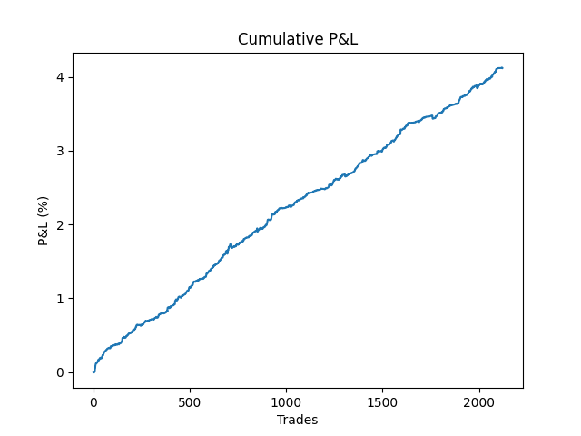
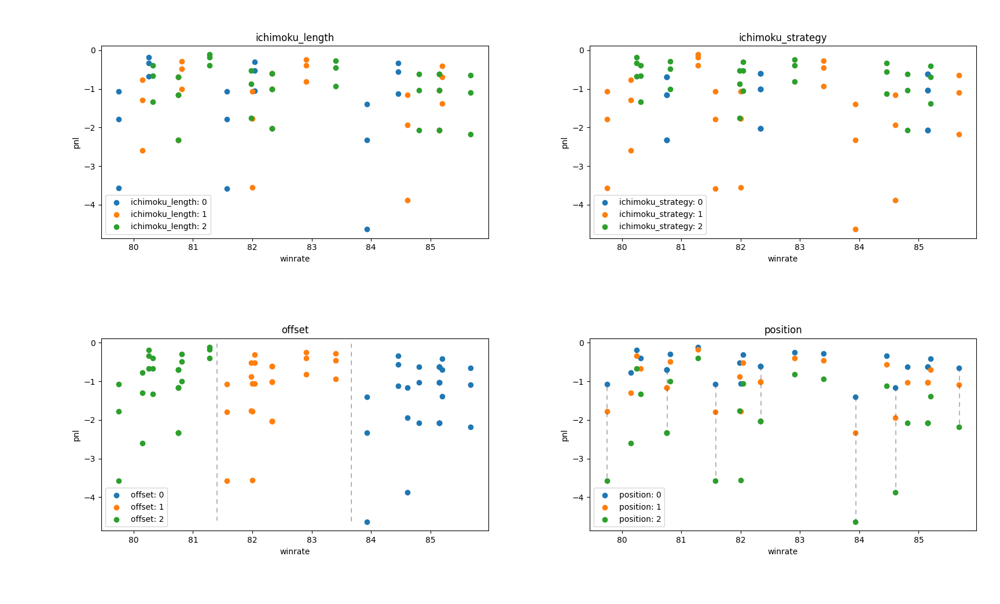
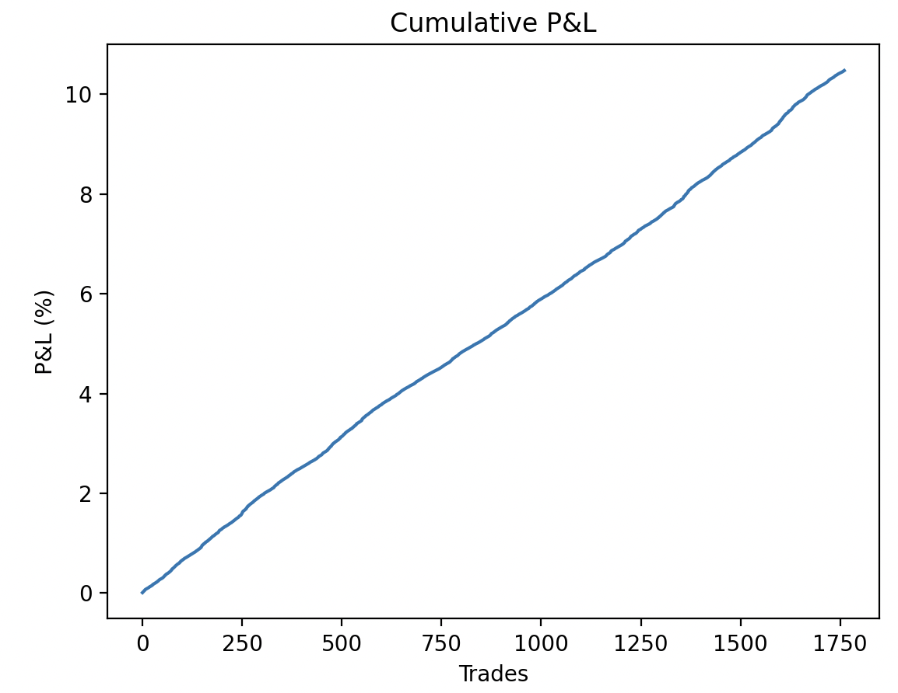
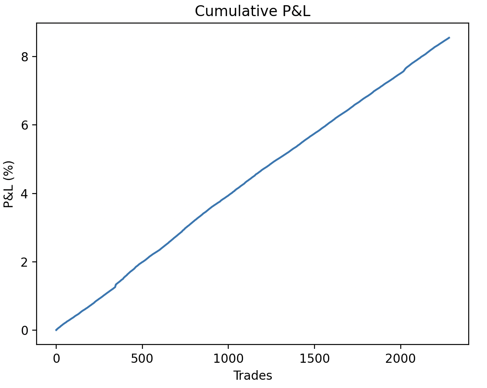

# Backtest Analysis
## Introduction
Backtesting a trading strategy is often underestimated process yet serves as a critical and fundamental step in the development and validation of any trading approach. Backtesting bridges the gap between theory and practice through providing valuable insight into the potential profitability and risk associated with the strategy as well as helping in fine-tuning and optimizing the strategy by identifying strengths and weaknesses. This document will record the backtesting result as well as key takeaways from it.
  

### Variables:
- **Ichimoku input**
- **Ichimoku strategy**
- **Directional market making offset**
- **Position size per trade**
- **Stop loss**
  

### Parameter of Interst:
- **P&L**
- **Win Rate**
- **Risk to Reward (R:R)**
- **Average Profit per Trade**
- **Average Loss per Trade**
  

## Backtest 1 - Algorithmic trading

### Method
1 replication was run on QQQ IEX data from Oct 1, 2019 to Nov 1, 2019 with following parameters:
- **Ichimoku input**: 9,26,52
- **Ichimoku strategy**: Conversion & base line cross
- **Position size per trade**: 10%
  
### Result

- **P&L**: 4.12%
- **Win Rate**: 57.26%
- **R:R**: 1.86

### Analysis

The algorithmic Ichimoku strategy was found to be profitable with 1 month return of 4.12%. Looking at relatively-low win rate of 57.26% but "good" R:R of 1.86, we can conclude that the strategy was mediocre in finding "good entries" but once found, it was promising in terms of profit. 
  

## Backtest 2 - Ichimoku Input, Strategy, Offset, Size VS P&L/Win Rate

### Method
81 replications were run on QQQ IEX data from Oct 1, 2019 to Nov 1, 2019 varying the following parameters:

- **Ichimoku input**:
    - 9, 26, 52
    - 7, 21, 42
    - 5, 13, 26

- **Ichimoku strategy**:
    - Conversion & base line cross
    - Lagging span & base line cross
    - Cloud change

- **Directional market making offset**:
    - 3 ticks
    - 5 ticks
    - 10 ticks
- **Position size per trade**:
    - 3%
    - 5%
    - 10%

### Result

- **Average P&L**: -1.24%
- **Average Win Rate**: 82.59%
- **Average R:R**: 0.4

### Analysis

The overall performance of all 81 replications was not good - no replication had a positive P&L. However, compared to the previous fully-algorithmic trading backtest, by implementing a market making strategy, the win rate improved significantly. 

Figure above visualizes the effect of variables vs P&L/Win rate. 

  
**Top left**: Ichimoku Length - 0: (9,26,52), 1: (7,21,42), 2: (5,13,26)

Change in Ichimoku input does not seem to have any effect in win rate. However, (5,13,26) ichimoku seems to outperform (7,21,42) and (9,26,52) ichimoku; due to the quick nature of market making strategy, ichimoku with more sensitive input could be entering the trade earlier than the other two, which leads to better performance.

**Top right**: Ichimoku Strategy - 0: BL/CL, 1: LS/BS, 2: Cloud

Cloud change strategy seems to be performing the best, followed by LS/BL cross strategy, and lastly CL/BL strategy. Win rate-wise, LS/BL cross strategy seems to be having the greatest variance, followed by cloud change strategy, and BL/CL cross with the smallest variance. This indicates that BL/CL strategy's win rate is less affected by other variables while LS/BL strategy's win rate is more affected by other variables.

**Bottom left**: Offset - 0: 3ticks, 1: 5ticks, 2: 7ticks

Unlike the previous two variables, directional market making offset has more evident impact in P&L and win rate. The greater the offset, the lower the winrate, which is intuitive (the more far apart take-profit price is, the lesser the probability of reaching it). P&L-wise, having the biggest offset had slightly better result; the greater the potential trade profit, the better the P&L.

**Bottom right**: Position Size per Trade - 0: 3%, 1: 5%, 2: 10%

Position size per trade is determined to have no impact in win rate; at this point of backtesting where slippage has been ignored, this makes sense. On the other hand, it had significant impact on P&L: the greater the size per trade, the greater the magnitude of P&L. This shows that once the strategy is "functioning," having a greater entry size per trade will have greater return but also greater risk.
  

### Rooms of Improvement
Market making strategy had a greater win rate but lower P&L in return. This could be from two reasons: 
1. R:R is not favorable (close to 1:1)
2. No stop loss is set currently

This insight provides two suggestions for the next backtest
- Employ both algorithmic trading and market making
    - For example, if trade was entered based on algorithmic signal, take half of the profit based on the market making strategy, and the other half to "ride" the micro-trend for greater return
- Set a stop loss
    - Find an ideal stop loss for market making strategy based on R:R

  
## Backtest 3 - Modified Strategy

### Method
2 backtests were run on QQQ and SPY IEX data from Oct 1, 2019 to Nov 1, 2019 varying the following parameters:

- **Ichimoku input**:
    - 5, 13, 26

- **Ichimoku strategy**:
    - Conversion & base line cross

- **Directional market making offset**:
    - 7 ticks

- **Position size per trade**:
    - 10%

In addition, some modifications were done:
1. Maximum 1 trade could be placed per candlestick
2. Ichimoku is now computed per candlestick, not per update
3. No trades were made outside the regular trading hours

### Result

**QQQ**
- **Total P&L**: 10.47%
- **Average P&L**: 0.01%
- **Average Win Rate**: 100.00%
- **Max Drawdown**: -0.01%

**SPY**
- **Total P&L**: 8.55%
- **Average P&L**: 0.01%
- **Average Win Rate**: 100.00%
- **Max Drawdown**: -0.01%

### Analysis
Both backtests returned 100% win rate without setting a stoploss. However, upon printing out the lists of trades and comparing with the market data, the backtest result seemed to be accurate. Potentially plausible explanation behind this could be that since no stoploss were set and take profit level is only 7 ticks away from the best bid and offer (BBO), once the microtrend has been identified, the trend worked in favor to reach the take profit level.

Our next goal is to implement Machine Learning to predict the microtrend beforehand to have a better entry points.
