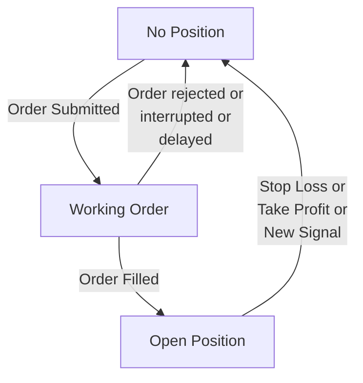
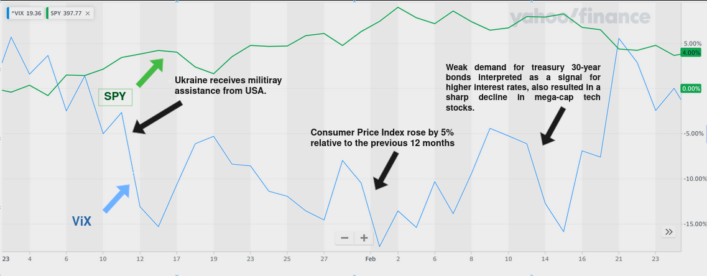
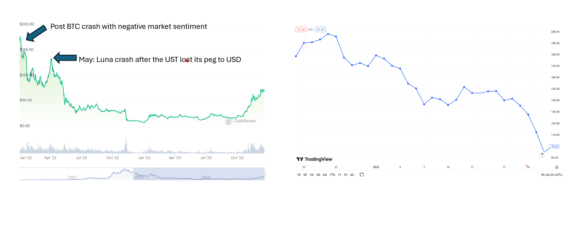
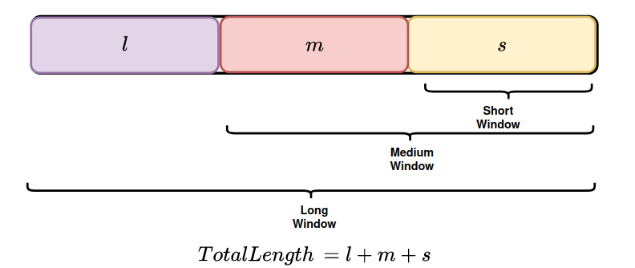
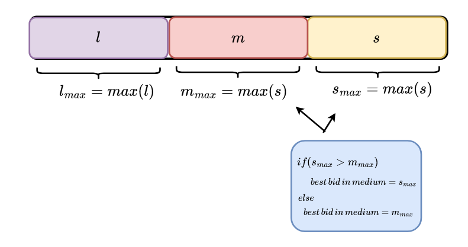
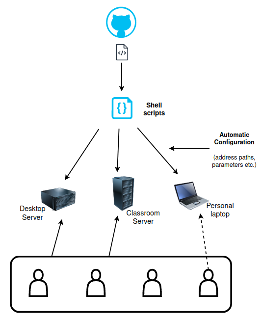
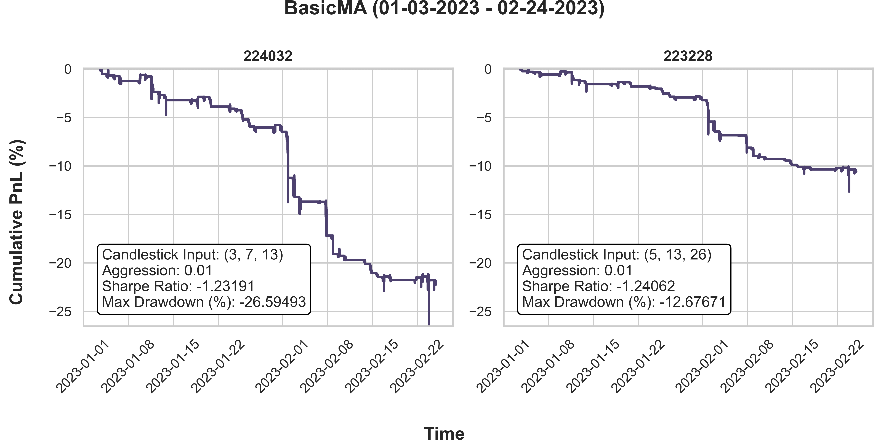
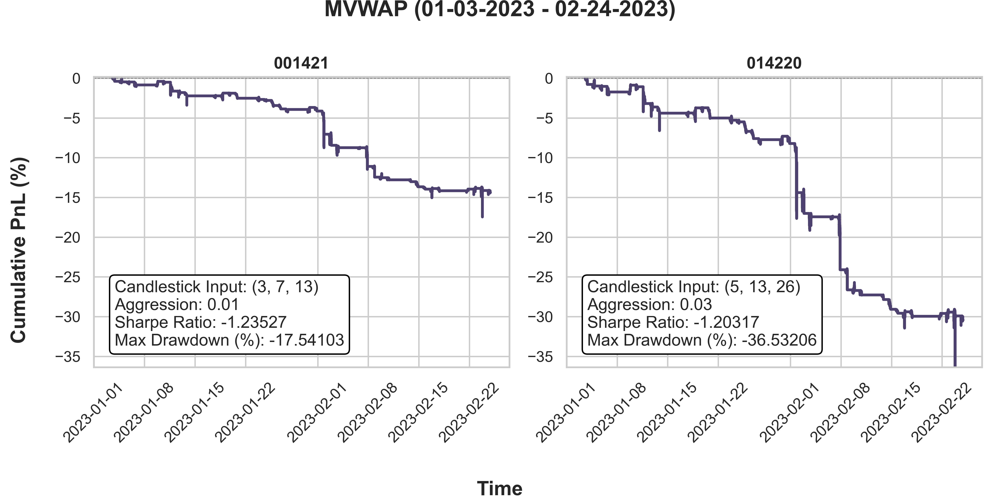
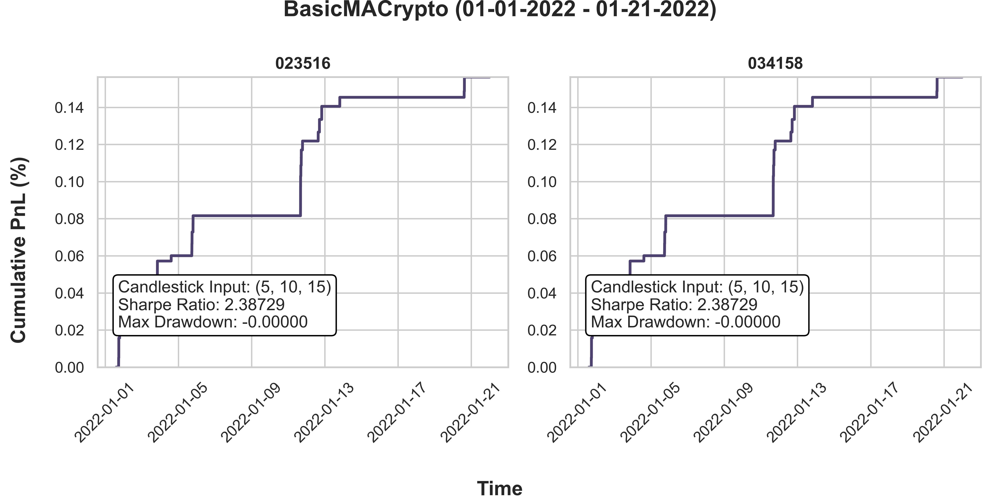
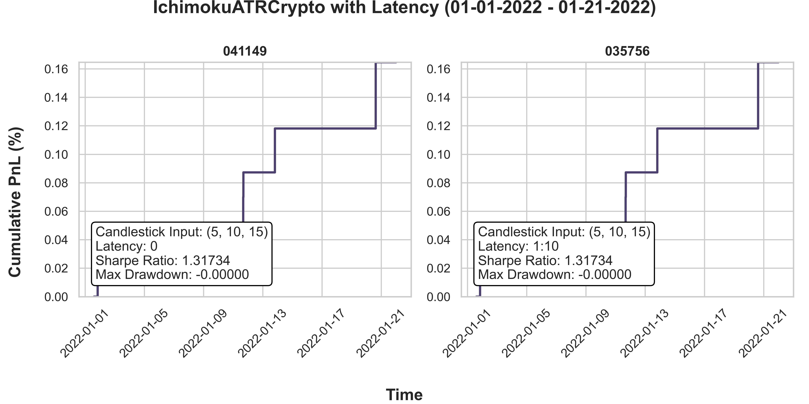

# Retail to HFT: Ichimoku Kinko Hyo with Machine Learning for Algorithmic Trading

[[_TOC_]]

## 1. Executive Summary

This strategy development project investigates the integration of retail trading strategies with high-frequency trading (HFT) market-making strategies, utilizing trade, quote, and order book update data sourced from the IEX exchange. The study aims to assess the performance of this combined approach in the US cash equities and cryptocurrencies market, with a backtesting period spanning from January 3, 2023, to February 24, 2023.

The research methodology involves the development and implementation of a comprehensive algorithmic trading framework that combines elements of both retail and HFT strategies. The selected dataset from IEX provides a granular view of market dynamics, enabling a detailed examination of trading signals, order execution, and market impact.

The results revealed suboptimal performance in the US cash equities market, where the implemented strategies incurred losses. This outcome prompts a deeper exploration into the factors contributing to the underperformance, including market conditions, liquidity constraints, and potential regulatory influences.

Surprisingly, a positive outcome is observed in the cryptocurrency market, where the same combined trading strategies prove to be profitable. The contrasting results between the traditional equity market and the crypto market raise questions about the transferability and adaptability of algorithmic trading strategies across different asset classes.

The findings underscore the importance of considering market-specific nuances and adapting strategies to the unique characteristics of different financial instruments. Future work may explore optimizations and refinements to the strategies, as well as further investigate the underlying factors driving performance disparities between traditional and cryptocurrency markets.

## 2. Introduction

## 2.1 The Team 

**Ashitabh Misra**
I am Ashitabh Misra, and I am pursuing a PhD in Computer Science at the University of Illinois at Urbana Champaign. His research spans compilers, probabilistic programming, IoT systems, and machine learning. Before this, I have done research in effecient Static Analysis for Cache-Miss Calculation for tiled kernels and Neural Network Compression techniques. My thesis is focused on devloping techniques to deploy probabilistic models and machine learning models on resource constrained for cyber-physical systems that perform real time classification. My courses include, Compiler Construction, Advanced Compiler Construction, Mobile Robotics, Advanced Topics in Programming Systems. My programming experience entails creating a toy-language [ViX](https://ieeexplore.ieee.org/document/10137324) (embedded in C++, for low-precision probabilistic modeling), C++, C, Python, and Shell Scripting. I will be graduating in August 2025.
    
- Email: [misra8@illinois.edu](mailto:misra8@illinois.edu) 
- LinkedIn Profile: [Ashitabh Misra](https://www.linkedin.com/in/ashitabh-misra-700225150)

**Michael Bhang**
    
- Email: [mbhang2@illinois.edu](mailto:mbhang2@illinois.edu) 
- LinkedIn: [Min Hyuk Bhang](https://www.linkedin.com/in/michael-bhang/)

**Laxmi Vijayan**
I'm Laxmi (Lux) Vijayan, a Master's of Computer Science student at the University of Illinois Urbana-Champaign, set to graduate in August 2024. With over 6 years of experience in data analysis and human subjects research, I'm passionate about applying computational methods like network analysis to real-world challenges. During a recent 4-month NSF DREAM Fellowship at UIUC, I delved into unsupervised machine learning techniques and network analysis to uncover patterns in citation networks. I have experience in mobile development, working with IoT systems, and UI design.  My programming languages of choice are Python, Java, Ruby, and shell scripting.
    
- Email: [laxmiv2@illinois.edu](mailto:laxmiv2@illinois.edu) 
- LinkedIn: [Laxmi Vijayan](https://www.linkedin.com/in/luxvijayan/) 

 

**Akshay Pandit**
I am Akshay Pandit, a PhD student in Civil Engineering (Concentration: Computational Science and Engineering) with a Master's degree in Applied Statistics at the University of Illinois at Urbana-Champaign. My thesis focuses on understanding the impact of Food trade on agricultural variables. I am graduating in August 2025, and have taken courses in Time Series Analysis, Machine Learning, Regression Design, and Stochastic Processes. I have industry experience in the field of Data Science and Deep Learning as an intern at Caterpillar and Corteva Agriscience respectively. I am proficient in languages such as Python, R, C++ and Bash, and I am always willing to learn new languages. My interests include Machine learning, Finance, and Crypto.

- Email: [apandit2@illinois.edu](mailto:apandit2@illinois.edu)
- LinkedIn: [Akshay Pandit](https://www.linkedin.com/in/akshay-pandit)

## 2.2 The Idea 

We brought together a diverse array of expertise in fields ranging from computer science and industrial engineering to data analysis and civil engineering. While our collective experience spans areas like machine learning, data science, IoT systems, and computational methods, our experience in finance leans more towards retail trading and investment, than high frequency trading. In order to better understand the similarities and differences between the two areas, we chose implement and apply some common retail strategies in a high frequency context. We evaluated the performance of Ichimoku Cloud, moving averages, and other non-machine learning forecasting methods using backtesting. Our goal was to gain a better understanding of market microstructure, trading strategy development and backtesting, and lay the foundation for a deeper dive into HFT. 

## 3. Background
### 3.1 Ichimoku Kinko Hyo

Ichimoku Kinko Hyo (Japanese: 一目均衡表), often referred to as just "*Ichimoku*" or "*Ichimoku Cloud*" is a technical analysis tool that was developed in the late 1930s by the Japanese journalist Goichi Hosoda and released to the public in the 1960s. Ichimoku Kinko Hyo roughly translates to "one glance equilibrium chart," which emphasizes its ability to provide a holistic view of the market at a glance. 

At its core, Ichimoku is a visual analysis tool designed to help traders make sense of market trends, support and resistance levels, and potential reversal points rapidly. It provides a comprehensive snapshot of market equilibrium at a single glance, making it accessible to non-expert and retail traders. 

The five components of the Ichimoku Kinko Hyo are the: 
- Conversion Line (Japanese: 転換戦, Hepburn: *Tenkan-sen*), 
- Base Line (Japanese: 基準線, Hepburn: *Kijun-sen*), 
- Lagging Span (Japanese: 遅行, Hepburn: *Chikou*), 
- Leading Span A and Leading Span B (Japanese: 先行, Hepburn: *Senkou*), 
- and the Cloud (Japanese:雲, Hepburn: *Kumo*). 

#### 3.1.1 Conversion Line (*Tenkan-sen*)

The Conversion Line is a moving average of the absolute max and min price of the past few, typically nine, periods. The use of the absolutes in the average ensure that it is responsive to recent price action. The Conversion Line is a short-term indicator of trends in price; when the price is above the Conversion Line, it indicates a potential buying momentum. Conversely, when the price is below the Conversion Line, it may signify a short-term downward trend. 

It provides a smoothed price-action that is dynamic and responsive due to the use of a short timeframe and absolute max/min price in its calculation. 

#### 3.1.2 Base Line (*Kijun-sen*)

Like the Conversion Line, the Base Line uses the average of absolute max and min price, but is calculated over a larger period. Typically, the Base Line is calculated over 26 periods. Due to the larger period, the base line is less susceptible to short-term market noise. 

This is a medium-term indicator that provides a more stable perspective into price action, and helps traders identify sustained trends. 

#### 3.1.3 Lagging Span (*Chikou*)

The primary role of the Lagging Span is to confirm the current momentum in the market. It represents the current closing price plotted a set number of periods in the past, usually 26 periods behind the current period. This lag offers a visual confirmation of the current trend and price by comparing it to historical price action. 
The lagging perspective is particularly useful for confirming the strength of an existing trend and identifying potential turning points. 

#### 3.1.4 Leading Span A and Leading Span B (*Senkou*)

The leading spans are two averages plotted ahead of the current period to provide insight into the future support and resistance zones. 

Leading Span A is a composite average of the Conversion and Base Lines plotted 26 period into the future. By averaging the two lines, Leading Span A provides a smoothed representation of the short- and medium-term trends. It projects the equilibrium between these two trends indicators into the future as a midpoint. 

Comparatively, the Leading Span B is an average of the absolute max/min price of the past 52 periods plotted 26 periods ahead of the current period. This is a long-term indicator that  accounts for historical volatility. 
#### 3.1.5 Ichimoku Cloud (*Kumo*)

The Ichimoku Cloud is a dynamic area on the price chart bounded by the Leading Spans A and B. It provides a visual representation of the current and future potential support and resistance levels. The color and expansiveness of the cloud helps easily identify the prevailing trend. In an uptrend, the cloud is colored green and a more expansive cloud suggests a stronger, and potentially more reliable trend. In a downtrend, the cloud is colored red and a more expansive cloud is interpreted as a stronger and potentially more sustained downward trend. An expansive cloud can also be a marker of potential volatility in price, as prices have a wider support or resistance area.

#### 3.1.6  Crossovers and Signals

Crossovers between various components of the Ichimoku Kinko Hyo system, particularly the Conversion and Base Line, are key elements used by traders to generate signals. These crossovers can provide insights into potential changes in market momentum and trend direction.

1. **Conversion Line and Base Line Crossover:**
    
    - **Bullish Signal:** When the Tenkan-sen crosses above the Kijun-sen, it generates a bullish signal. This suggests a potential shift in short-term momentum to the upside.
    - **Bearish Signal:** Conversely, if the Tenkan-sen crosses below the Kijun-sen, it generates a bearish signal, indicating a potential shift in short-term momentum to the downside.
    
2. **Leading Span A and Leading Span B Crossover:**
    
    - **Bullish Signal:** When Leading Span A crosses above Leading Span B, it generates a bullish signal. This crossover suggests a potential shift in overall trend momentum to the upside.
    - **Bearish Signal:** If Leading Span A crosses below Leading Span B, it generates a bearish signal, indicating a potential shift in overall trend momentum to the downside.

These crossovers are often used in combination to confirm trading signals. For example, a bullish Conversion Line and Base Line crossover, coupled with Leading Span A crossing above Leading Span B, may strengthen the conviction in a bullish trend.

#### 3.1.7 Advantages of Ichimoku 

One advantage of Ichimoku is the holistic, comprehensive view it provides of market conditions. Trends, support and resistance, and potential reversal points can easily be identified. Its primary advantage, however, is its adaptability–the timeframes can be customized, making it suitable even for intraday trading. 

#### 3.1.8 Disadvantages of Ichimoku 

There are a few notable disadvantages of Ichimoku as a primary technical analysis tool. Ichimoku indicators are modified moving averages and they share the disadvantages of other moving average indicators– they not perform well in choppy or laterally trading markets. Another disadvantage is also the inherent subjectivity in how the different signals can be interpreted. Finally, while Ichimoku provides a comprehensive view of market conditions, it can be susceptible to false signals. 

### 3.2 Forecasting without Machine Learning

Forecasting without machine learning relies on traditional statistical methods and econometric models. These earlier models view financial markets as static data-generating processes, applying statistical algorithms like regression analysis to market data. This approach aims to uncover the intrinsic nature of market behaviors, facilitating inferences and predictions to guide trading and investment decisions. 

Some notable non-ML models for forecasting in this area are ARIMA (AutoRegressive Integrated Moving Average) and GARCH (Generalized AutoRegressive Conditional Heteroskedasticity). Both are statistical models used in time series analysis, particularly in the fields of economics and finance.

ARIMA models are primarily used for forecasting non-stationary time series. They combine autoregressive (AR) and moving average (MA) models and integrate them to make the time series stationary. The variable of interest in ARIMA is regressed on its own lagged values and the moving average models the error as linear combination of terms that occurred contemporaneously and at prior time points. The differencing of raw observations allows for stationary time series, which is a key step in the modeling process. 

On the other hand, GARCH models are used to estimate the volatility of financial time series. Volatility, in this context, refers to the amount of uncertainty or risk about the size of changes in a security's value. A GARCH model can capture the 'volatility clustering' phenomenon often observed in financial markets, where periods of high volatility are followed by high volatility and low volatility is followed by low volatility. The model does this by assuming that future volatility depends on past squared returns and past variances, hence providing a dynamic and conditional approach to modeling time series data.

Both ARIMA and GARCH models are valuable for different aspects of financial analysis: ARIMA for forecasting price movements or economic indicators and GARCH for understanding and predicting the volatility in financial returns. Combining these models can be particularly powerful, using ARIMA to forecast returns and GARCH to model the changing risk or volatility associated with those returns.

While we explored both ARIMA and GARCH, we chose to start with an even simpler models for our first exploration in HFT, since our primary goal was interpretabilty and understanding the behavior of our strategy, not profit and loss. 

### 3.3 Trading and Market Microstructure

Market microstructure refers to the detailed organizational and operational aspects of financial markets that determine how assets are traded. It examines the dynamics of order placement, price formation, trade execution, and information dissemination within a market.

#### 3.3.1 Bid and Ask

**Bid Price** 
* The maximum price that a buyer is willing to pay for a security.
* The best bid price is the highest bid price.
* Represents the demand side of the market.

**Ask (Offer) Price**
* The minimum price at which a seller is willing to sell a security.
* The best ask price is the lowest ask price.
* Represents the supply side of the market.

**Bid-Ask Spread**
* The difference between the best bid and offer (BBO).
* Reflects the cost of trading and represents the profit potential for market makers.
* Narrower spread generally indicates higher liquidity.

#### 3.3.2 Order Book

The order book is a dynamic, real-time electronic record of buy and sell orders organized by price level for a specific security. It plays a central role in market microstructure, providing transparency into the current supply and demand by informing on price, availability, depth of trade, and who initiates transactions. Three major components of an order book are: 

- Buy orders (bids) 
- Amount of existing buy orders are organized per price level 
- The highest bid located on top of the book 
- Sell orders (asks) 
- Amount of existing sell orders are organized per price level 
- The lowest ask located on top of the book 
- Order History 
- Records and shows all transactions that happened in the past

## 4. Tools and Technologies
### 4.1 Programming Languages
- **Bash:** A command-line language commonly used in Unix and Linux environments for scripting and automation. It excels at handling system tasks, file operations, and executing commands in a shell environment. It was used primarily for file operations.

- **C++:** A high-performance programming language widely used in finance for its efficiency and speed. It is particularly suitable for developing components of the trading strategy that require low-level memory manipulation and optimal execution. It was employed for performance-critical components of the strategy.

- **Python:** A versatile and widely adopted programming language known for its readability and ease of use. Python is often chosen for rapid development, data manipulation, and as a general-purpose language. It was the primary language for overall strategy development and implementation.

### 4.2 Frameworks
- **[Pandas](https://pandas.pydata.org/):** A powerful data manipulation library for Python, providing data structures like DataFrames that are essential for handling and analyzing structured data efficiently. It was used for data manipulation. 

- **[NumPy](https://numpy.org/):** A fundamental package for scientific computing with Python, enabling efficient handling of large, multi-dimensional arrays and matrices, along with mathematical functions to operate on these data structures. It was used for numerical operations. 

- **[Matplotlib](https://matplotlib.org):** A comprehensive 2D plotting library for Python. It produces publication-quality figures in a variety of formats and interactive environments across platforms. Matplotlib can be used to generate plots, histograms, power spectra, bar charts, error charts, scatterplots, and more. It serves as the foundation for many other plotting libraries and is highly customizable.

- **[Seaborn](https://seaborn.pydata.org):** A statistical data visualization library based on Matplotlib. It provides a high-level interface for drawing attractive and informative statistical graphics. Seaborn comes with several built-in themes and color palettes to make it easy to create aesthetically pleasing visualizations. It was particularly useful for exploring and understanding complex datasets.

- **[Plotly](https://plotly.com/python/):** A versatile graphing library that allows interactive plotting. It supports a wide range of chart types, including line charts, scatter plots, bar charts, and more. Plotly is particularly known for its ability to create interactive, web-based visualizations. It was used for result analytics and interactive charts. 

- **[PyTorch](https://pytorch.org/):** An open-source deep learning framework that facilitates the development and training of neural networks. PyTorch is known for its dynamic computational graph, making it popular for research and development in deep learning. This was used to train our models, then export the model files. 
### 4.3 Software and Libraries

- **[RCM Strategy Studio](https://rcm-x.com/principal-trading-software/):** RCM-X generously offered us a licence for its principal trading Software, Strategy Studio. Strategy Studio is a trading software designed for backtesting and optimizing trading strategies, providing a comprehensive environment for evaluating the performance of algorithms.

- **[Jupyter Notebooks](https://jupyter.org/):** An open-source web application that allows for creating and sharing documents that contain live code, equations, visualizations, and narrative text. It is widely used for interactive data analysis and exploration. It was primarily utilized for interactive data analysis and exploration.

- **[GitLab](https://gitlab.com/):** A web-based Git repository manager that provides version control, collaboration, and continuous integration features. GitLab was used to manage and track changes to the source code, facilitating collaborative development and maintaining a version history of the project.

## 5. Data  
Data quality is a cornerstone of High Frequency Trading (HFT) and quantitative trading strategies. These strategies rely on mathematical models to make rapid trading decisions and are limited by the quality of the data used to develop and trade them. Quality data ensures robust, adaptable models that reflect the dynamic nature of markets. Further, HFT strategies often involve exploiting small price differentials or inefficiencies in the market. To effectively capitalize on these imbalances, analyzing high quality data will provide insight into order book dynamics, trade flows, and price movements at a granular level. Once a strategy has been developed, historical data is used to backtest and evaluate the performance of a strategy. Accurate historical data is essential for assessing the viability of a strategy and understanding its potential risks and returns. 

In order to ensure that we were building our strategies on a strong foundation, we evaluated and used several sources. We implemented strategies on two financial assets: cash equities and crypto currency. We interested in examining the adaptability of our strategies, evaluating their performance with different asset classes, and understanding how these asset classes behaved. Here, we describe the sources, the type of data retrieved, the process of retrieval and parsing, and the integration of the sources in our strategy development process. 

### 5.1 Data Sources
#### 5.1.1 IEX 
#### 5.1.1.2 IEX TOPS

Investors Exchange (IEX)'s TOPS data feed provides real-time top-of-book quotations, last sale information, short sale restriction status, regulatory trading status, and auction details directly from IEX. The aggregated size of quotations received via TOPS does not reveal individual order details at the best bid or ask, but aggregated orders at the price level. Last trade price and size information is provided, reporting trades from both displayed and non-displayed orders on IEX, while routed executions are not reported. TOPS focuses specifically on the top of the order book. We utilized the tick data in our preliminary analysis. 

#### 5.1.1.3 IEX DEEP

The Investors Exchange (IEX)'s DEEP data feed offers real-time depth of book quotations and last sale information for IEX-listed securities. It provides the aggregated size of resting displayed orders at a given price and side during auctions, along with security-related administrative messages and event controls. Notably, DEEP does not disclose individual order details, such as non-displayed or reserve orders. It also conveys short sale restriction status, trading status, operational halt status, and security event information. While TOPS focuses specifically on top of the order book, DEEP offers a comprehensive view of the market depth.  DEEP's level of granularity is crucial for quant strategists interested in strategy development and backtesting, because it allows them to study liquidity, latency, other market dynamics, and optimize their strategies. The data from DEEP was used for backtesting. 

#### 5.1.1.4 Downloading and Parsing Data Feeds

We utilized the IEX Downloader Parser (UIUC internal GitLab) developed by David Lariviere to download and parse PCAP files. 

#### 5.1.2 Crypto
We used the historical market depth order book data from [gate.io](https://rcm-x.com/principal-trading-software/). The data is provided on per hour basis and is the comma-separated values file format. For the purposes of backtesting on Strategy Studio, we needed to merge the per hour files. To achieve seamless download and merge of the data obtained from *Gate.io*, we created a bash script that asynchronously downloads the hourly files and merges them together to generate daily files.

The raw data obtained from *Gate.io* has the following fields:

- Timestamp: Order filling time, in seconds, accurate to 1 decimal place
- Side: Direction of trade, 1: Sell 2: Buy
- Action: 
   - set: This is the base state of the orderbook before it starts registering trade for the given hour. This the base quantity for other action types to work with. 
   - take: It is the action which removes liquidity from the market at a given price level.
   - make: It is the action which adds liquidity from the market at a given price level. 
- Price: Depth price
- Amount: Depth quantity, unit: base currency, such as BTC for BTC_USDT
- Begin_Id: An id for the start of the Depth change 
- Merged: The number of merged records when there is a change in the depth

For more information, please see this [file](./Analytics/crypto/gateio_l2_data_script.sh).

The data reported has time granularity of 100 milliseconds which means if a number of transactions or orders were made within a 100 millisecond period then it will merge them together as one order. 

Once we obtained the day-level data, we wrote a python script to parse it in the format that Strategy Studio requires. Since the format for Strategy Studio data feed is quite different from the raw data provided, we had to process the raw data to replicate the tick level data needed for Strategy Studio. Three main actions that were required for replication were:

- The *action* = *set* values need to be used for the very first hour of the first day from where we want to run the backtesting. This is because that hour will have the starting state of the backtest duration. Then we remove the rest of the set action values since those values are already being captured by the previous hour order book data.
- Adjust the price to six decimal digits with four trailing zeroes and scale the quantity values to integer values. To avoid turning fractional quantities to become 0, we scale them by multiplying with relevant orders of magnitude.
- To obtain price level order book data, we cumulatively calculate the amount at each price level.
- Taking care of partially filled orders through a large market order that removes liquidity from multiple price levels.

We created a python script to parallelize data processing by breaking the daily files into hourly DataFrames before merging them together. These DataFrames are then fed to the parser which converts the data into format required by Strategy Studio. Please see this [file](./Analytics/crypto/gateio_l2_data_parser.py) for more information. 

Lastly, we wrote a bash script to efficiently run the parser. This script accepts various parameters for input directory, output directory, and symbols. More information can be found hereFor more information read this [file](./Analytics/crypto/gateio_l2_data_parser.sh).

### 5.2 Preliminary Research and Analysis

#### 5.2.1 Exploratory Research and Data Analysis

We dedicated several months to understanding the challenges of working with non-stationary high frequency tick data. Using some sample data, we examined intra-day patterns in high volume stocks such as SPY, AAPl, and QQQ.

Some of our exploratory research involved understanding what statistical models could be applied to non-stationary time series data. After exploring ARIMA and GARCH models, we decided to take a much simpler approach of utilizing various versions of moving average for our first implementation. This also tied in with our interesting in utilizing Ichimoku, a popular technical analysis tool our team had prior experience with. 

After selecting Ichimoku and moving averages as our primary startegy, we examined intra-day volatility of high volume stocks such as SPY, APPL, and QQQ. We determined that despite there being more volatility at start of trading, it would be possible to leverage micro-trends and profit through out the course of the trading day with Ichimoku. Then, we proceeded to implement a python version where we could test this. 

#### 5.2.2 Python-Based Strategy Backtesting

Backtesting a trading strategy is an often underestimated process, yet serves as a critical and fundamental step in the development and validation of any trading approach. Backtesting bridges the gap between theory and practice through providing valuable insight into the potential profitability and risk associated with the strategy as well as helping in fine-tuning and optimizing the strategy by identifying strengths and weaknesses. This document will record the backtesting result as well as key takeaways from it.

|        Independent Variables      |   Performance Metrics of Interest                    |
|:----------------------------------|:-----------------------------------------------------|
| Ichimoku input                    | P&L                                                  |
| Ichimoku strategy                 | Win Rate                                             |
| Directional market making offset  | Risk to Reward (R:R) = Avg Profit / Avg Loss         |
| Position size per trade           | Average Profit per Trade                             |
| Stop-loss                         | Average Loss per Trade                               |

##### 5.2.2.1 Backtest 1 - Algorithmic Ichimoku (Algorithmic)

One backtest was run on QQQ IEX historical data from October 1, 2019 to November 1, 2019 using the following parameters: 

- **Ichimoku Input (short, mid, long):** (9, 26, 52)
- **Strategy:** Conversion and Base Line Cross
- **Position Size/Trade:** 10%

###### 5.2.2.1.1 Results

 
- **P&L**: 4.12%
- **Win Rate**: 57.26%
- **R:R**: 1.86

###### 5.2.2.1.2 Analysis

The algorithmic Ichimoku strategy was found to be profitable with 1 month return of 4.12%. While the win-rate was low (57.26%), the relatively good risk-to-reward ratio of 1.86, we can surmise that while the strategy was mediocre at finding good entry points, when it did find them, it was promising in terms of profit. 

##### 5.2.2.2 Backtest 2 -  Ichimoku Input, Strategy, Offset, Size VS P&L/Win Rate

We ran 81 trials on QQQ IEX data from October 1, 2019 to November 1, 2019 using the following parameters: 

- **Ichimoku Input (short, long, mid):**
	- **First Set:** (9, 26, 52) 
	- **Second Set:** (7, 21, 42)
	- **Third Set:** (5, 13, 26)
- **Strategy:** 
	- Conversion and Base Line Cross,
	- Lagging Span & Base Line Cross, 
	- Cloud Change
- **Position Size/Trade:** 
	- 3%
	- 5%
	- 10%

###### 5.2.2.2.1 Results

- **Average P&L**: -1.24%
- **Average Win Rate**: 82.59%
- **Average R:R**: 0.4

**Top left**: Ichimoku Length - 0: (9,26,52), 1: (7,21,42), 2: (5,13,26)

Change in Ichimoku input does not seem to have any effect in win rate. However, (5,13,26) ichimoku seems to outperform (7,21,42) and (9,26,52) ichimoku; due to the quick nature of market making strategy, ichimoku with more sensitive input could be entering the trade earlier than the other two, which leads to better performance.

**Top right**: Ichimoku Strategy - 0: BL/CL, 1: LS/BS, 2: Cloud

Cloud change strategy seems to be performing the best, followed by LS/BL cross strategy, and lastly CL/BL strategy. Win rate-wise, LS/BL cross strategy seems to be having the greatest variance, followed by cloud change strategy, and BL/CL cross with the smallest variance. This indicates that BL/CL strategy's win rate is less affected by other variables while LS/BL strategy's win rate is more affected by other variables.

**Bottom left**: Offset - 0: 3ticks, 1: 5ticks, 2: 7ticks

Unlike the previous two variables, directional market making offset has more evident impact in P&L and win rate. The greater the offset, the lower the winrate, which is intuitive (the more far apart take-profit price is, the lesser the probability of reaching it). P&L-wise, having the biggest offset had slightly better result; the greater the potential trade profit, the better the P&L.

**Bottom right**: Position Size per Trade - 0: 3%, 1: 5%, 2: 10%

Position size per trade is determined to have no impact in win rate; at this point of backtesting where slippage has been ignored, this makes sense. On the other hand, it had significant impact on P&L: the greater the size per trade, the greater the magnitude of P&L. This shows that once the strategy is "functioning," having a greater entry size per trade will have greater return but also greater risk.

###### 5.2.2.2.2 Analysis
The overall performance of all 81 replications was not successful; none of the trials had a positive P&L. However, we improved the win-rate here by implementing a market-making strategy, as compared to the previous fully-algorithmic trading backtest. 

Market making strategy had a greater win rate, but lower P&L in return. This could be from two reasons: 
1. R:R is not favorable (close to 1:1)
2. No stop loss is set currently

This insight provides two suggestions for the next backtest
- Employ both algorithmic trading and market making
    - For example, if trade was entered based on algorithmic signal, take half of the profit based on the market making strategy, and the other half to "ride" the micro-trend for greater return
- Set a stop loss
    - Find an ideal stop loss for market making strategy based on R:R
##### 5.2.2.3 Backtest 3 - Modified Strategy

Two trials were run on QQQ and SPY IEX data from October 1, 2019 to November 1, 2019 varying the following parameters:

- **Ichimoku Input (short, mid, long):** (5, 13, 26)
- **Ichimoku strategy:** Conversion and Base Line Cross
- **Directional Market Making Offset**: 7 ticks
- **Position Size/Trade:** 10%

A further few modifications were included in these backtests based on previous results: 
1. A maximum of one trade was permitted per candlestick.
2. Ichimoku was now computed per candlestick, rather than per update.
3. Trades were limited to trading hours.

###### 5.2.2.3.1 Results

**QQQ**
- **Total P&L**: 10.47%
- **Average P&L**: 0.01%
- **Average Win Rate**: 100.00%
- **Max Drawdown**: -0.01%

**SPY**
- **Total P&L**: 8.55%
- **Average P&L**: 0.01%
- **Average Win Rate**: 100.00%
- **Max Drawdown**: -0.01%
###### 5.2.2.3.2 Analysis

Both backtests returned a 100% win rate without setting a stop-loss. This was surprising, but confirmed by comparing the lists of trade with the market data. One plausible explanation could be because no stop-loss was set; with take profit level being only 7 ticks away from the best bid and offer (BBO), the identified micro-trend worked in our favor to reach the profit level. 

## 6. Strategy Overview
In this section, we will provide the flow of the strategy implementation and along with the technical indicators that we used. We build four strategies and tested them on two different asset classes, namely, cash equity and cryptocurrencies. The assets used are SPY (for cash equity) and Solana (SOL for cryptocurrencies). We will discuss the reason for their selection in the discussion section.
### 6.1 Finite State Machine

We kept the general principles of our strategy simple. Each trading period, we will start with no positions. When we receive a trading signal, an order will be submitted. Orders are not necessarily always filled. In our backtesting system, orders can be rejected due to submission errors or placing a limit order out of the scope of the order book. In the real world, this could the result of latency or packet loss. In this case, we will return to our no position state. If the order is filled, then we have an open position. This position will be closed when receive a new signal, reach our stop loss price, or take profit. In other words, we only maintain one open position at any given time.

### 6.2 Backtesting Period

For traditional cash equity algorthmic trading we have chosen a period from 3rd January 2023 to 24th February 2023. For cash equity, the backtesting period was specifically chosen to highlight a high volatility period in the stock market. This uncertainity and above average volatility was fueled by the rising CPI in USA and the Ukraine and Russia conflict. The plot below highlights the movement of ViX index, and annotated by some important geopolitical and socioeconomic events.

For cryptocurrency algorthmic trading we have chosen a period from 1st January 2022 to 21st January 2022 and the asset chosen is Solana (SOL). The backtesting period was specifically chosen to highlight the bearish market sentiment between the post BTC crash after hitting the peak in Novemeber and LUNA UST peg drop in May 2022.

### 6.3 Universal Technical Indicator: Ichimoku Candlesticks

### 6.3.1 Technical Indicators

Moving Average (MA): Moving Average is a technical indicator that smoothens price data to create a single flowing line of average price. It is calculated by averaging a set of past close prices over a specific period and this helps identify trends by filtering out short-term fluctuations (noises). The two main types are the Simple Moving Average (SMA), which gives equal weight to all prices, and the Exponential Moving Average (EMA), which assigns more weight to recent prices, making it more responsive to current market conditions. Multiple Moving Averages could be utilized to identify potential trade opportunities where a shorter period Moving Average crossing over a longer period Moving Average is perceived as a buy signal and vice versa. 

Volume Weighted Average Price (VWAP): VWAP is a trading indicator that takes account into both price and trading volume. It is calculated by dividing the cumulative sum of the close price multiplied by volume by the cumulative volume over a specific period. VWAP provides the average price at which a security has traded throughout the day, helping to identify potential trends and evaluate the price effectiveness of trades relative to market conditions. 

Average True Range (ATR): The Average True Range is a volatility indicator that measures market volatility by considering the average range between the high and low prices over a specified period. As a result, ATR is not concerned with the direction of price movement but rather a dynamic measure of volatility, adapting to changes in market conditions.
### 6.3.2 Ichimoku Candlesticks

To prevail in the rapid nature of the financial market, especially since we are interested in high frequency trading, special personalized candlesticks have been used. It is similar to 1 tick timeframe candlestick where a new candlestick is drawn every trade, but it has several modifications:

1. Same last traded price is disregarded
   a. Suppose the last 4 traded prices are $99.99, $100.00, $100.00, and $100.01. Then this would generate 3 candlesticks; one with close price of $99.99, another one with that of $100.00, and the last one with that of $100.01. 

2. Open, High, Low, Close is computed differently

   a. Open = last traded price
   b. High = best ask since the last trade
   c. Low = best best bid since the last trade
   d. Close = current mid price, but once trade has occurred at a unique price, the new last traded price.

   **Note**: Since candlestick disregards consecutive same traded price, open and close for the completed (non-current) candlestick could not be the same.

Benefits of employing this specialized candlestick is that it allows us to react faster to the shift in market micro-trend due to the candlesticks swiftness and sensitivity. In addition, all of the technical indicators will be computed using this candlestick as an input.

#### Candlestick Queue Optimization

The main functionality needed from the `class CandlestickQueue`is effeciently provide the best bid and ask within the Short, Medium and Long Window. First, we use the `dequeue` data structure to perform effecient pop, push and random access of elements. Second, iterating over each window and making redundant passes leads to significant performance bottlenecks. Instead we only iterate over the smaller windows and perform a simple comaprison over the Best Ask, Bids in each window. For example, we only need to compare the best ask in Medium Window and Best ask of `l` (shown in figure below). This improves the effeciency from `O((l + m + n) * (m + n) * (n))` to `O(l*m*n)`. There are more effecient algorithms using multiple Dequeus to do it in `O(1)` time update, but this sufficed our use case.

 

 

### 6.3 Cash Equity Strategies 

The moving average is computed by taking an average of the close price of past specific periods. Suppose the n-period moving average is being computed with a close price cn-1 (close price n periods ago), …, c0 (current close price), and a forecasted close price cf. If the current n-period moving average = mean(cn-1, …, c0) then the predicted n-period moving average = mean(cn-2, …, c0, cf). While the forecasted close price would follow the Gaussian Distribution, its expected value would be its mean, which is the open price). Therefore, the predicted n-period moving average = mean(cn-2, …, c0, c0).

**Basic MA**
	• Parameters: 
		• Short Period: 3 or 5 
		• Long Period: 7 or 13 
	• Trade Condition: 
		• Buy: Short MA crosses over Long MA      
		• Sell: Short MA crosses below Long MA 

**Market Making VWAP** 
	• Parameters: 
		• Short Period: 3 or 5 
		• Long Period: 7 or 13 
	• Trade Condition: 
		• Buy: Short VWAP crosses over Long VWAP 
		• Sell: Short VWAP crosses below Long VWAP 

ATR, which indicates the expectation of candlesticks’ length from low to high, could be used to forecast the very next candlestick and its technical indicator values. The most probable open price of the candlestick to be forecasted would be the last candle’s close price. The expected high and low of the candlestick would be open price + ATR2 and open price - ATR2, respectively: Assuming that the upward and downward potential for the next candlestick is equal for simplicity, then the high and the low would be equal to each other, which is the half of the candlestick length. Ultimately, the forecasted close price would follow the Gaussian (Normal) Distribution with its mean of open price. Upon computing the expected next candlestick, the forecast could be made on the indicator as well.

**Market Making: Basic MA with ATR Prediction** 
	• Parameters: 
		• Short Period: 3 or 5 
		• Long Period: 7 or 13 
	• Trade Condition: 
		• Buy: Predicted Short MA crosses over Predicted Long MA 
		• Sell: Predicted Short MA crosses below Predicted Long MA 

The Conversion Line and Base Line are computed by taking a middle price of the highest high and the lowest low of past specific periods but with the Base Line computed for a longer period. Suppose the n-period Conversion Line is being computed with a high price hn-1 (high price n periods ago), …, h0 (current high price), low price ln-1 (low price n periods ago), …, l0 (current low price), and a forecasted high and low of hf and lf, respectively. If the current n-period Conversion Line = mean(max( hn-1, …, h0), min(ln-1, …, l0)) then the predicted n-period Conversion Line = mean(max( hn-2, …, h0, hf), min(ln-2, …, l0, lf)). Substituting hf and lf in terms of cf and ATR, the predicted n-period Conversion Line = mean(max( hn-2, …, h0, cf+ ATR2), min(ln-2, …, l0, cf- ATR2)).

**Market Making Ichimoku with ATR Prediction** 
	• Parameters: 
		• CL Period: 3 or 5 
		• BL Period: 7 or 13 
	• Trade Condition: 
		• Buy: Predicted CL crosses over Predicted BL
		• Sell: Predicted CL crosses below Predicted BL 

### 6.3 Crypto Strategies
We implemented the same three of the four strategies we used for cash equities. The parameters.

**Basic MA**
	• Parameters: 
		• Short Period: 5 or 7 
		• Long Period: 15 or 20 
	• Trade Condition: 
		• Buy: Short MA crosses over Long MA      
		• Sell: Short MA crosses below Long MA 

**Market Making VWAP** 
	• Parameters: 
		• Short Period: 5 or 7 
		• Long Period: 15 or 20 
	• Trade Condition: 
		• Buy: Short VWAP crosses over Long VWAP 
		• Sell: Short VWAP crosses below Long VWAP 

**Market Making Ichimoku with ATR Prediction** 
	• Parameters: 
		• CL Period: 5 or 7 
		• BL Period: 15 or 20 
	• Trade Condition: 
		• Buy: Predicted CL crosses over Predicted BL
		• Sell: Predicted CL crosses below Predicted BL 

## 7. Backtesting and Results
### 7.1 Strategy Studio Setup
 

We created a setup where all team mebers can seamlessly run the comman main branch, from mlutiple servers without performing any manual setup. This was in addition to the Professors scripts which were setup for a vagrant virtual machine. We have modified those scripts to run on multiple servers.

### Compilation Flags

`Aggression=true\false` : whether to us aggression parameter or not.

`AggressionMultiplier`: (double) the importance given to the estimated aggression in the directional market making strategy.

`SpreadTick`: Set spread

`ShortWindow`: Set shortwindow size

`MediumWindow`: Set Medium Window size

`LongWindow`: Set Long Window size

Note: All Window sizes needed to be given if moving away from the default values.

### 7.2 Tuning parameters
Across our implemented strategies, we considered 6 parameters, namely:

1. Short moving window: Our various strategies utilize three different moving windows. The short moving window calculates the moving average price of the last *n* trading prices, where *n*  is the window size. The default value for short window is 5.
2. Medium moving window: The medium moving window calculates the moving average price of the last *n* trading prices, where *n*  is the window size. The default value for medium window is 10.
3. Long moving window: The long moving window calculates the moving average price of the last *n* trading prices, where *n*  is the window size. The default value for long window is 15.
4. Aggression: To control for the high frequency update of top quotes of the order book on ask and bid side, we use an aggression factor flag in all of our strategies for our limit orders to potentially ensure that the placed order is getting filled. The flag allows for dynamic aggression when set to true. We perform dynamic aggression making aggression as a function of top quote, minimum price in a short window of last 5 trades and the moving average price. We consider two cases: Mild and Strong aggression. For a case where the top ask quote is greater than the minimum price of the last 5 traded price, we provide a mild aggression and in our backtesting we have kept it 0. When the top ask quote is less than the minimum price of the last 5 traded price, we provide a strong aggression and it is expressed as

`abs(multiplier*(top_ask_price - min_price_short) / (min_price_short - average_closing_price_short_window))` 

where the *multiplier* is the aggression multiplier, *top_ask_price* is the current highest ask price, *min_price_short* is the minimum price of the last 5 trades, and *average_closing_price_short_window* is the moving average of the last 5 trade prices. 

Similarly, for the bid side, when the top bid quote is greater than the minimum price of the last 5 traded price, we provide a strong aggression which is expressed as

`abs(multiplier*(closing_price - min_price_short) / (min_price_short - average_closing_price_short_window))`

where *top_bid_price* is the current lowest bid and other variables have their usual meanings. 
Similarly, when the top bid quote is less than the minimum price of the last 5 traded price
we implement a mild aggression of 0.

5. Aggression multiplier: The *multiplier* in the aggression flag is a critical parameter to define the amount of aggression we want to pass through in our trades. A default value of 0.01 had been found to be optimal in our backtesting performance. It can be changed to smaller or larger values for milder or stronger dynamic aggression respectively.

## 8. Backtesting and Results 

### 8.1 Cash Equity Backtesting 

 

### 8.2 Crypto Backtesting

## 9. Discussion 
### 9.1 Performance Analysis

Contrary to our hope of developing a profitable interdisciplinary HFT trading strategy involving both retail and market microstructure concepts, our strategies were only found to be profitable for the cryptocurrency market but not for the US cash equities market. The following reasons could be the reasoning behind such lack of performance:

1. Due to budgeting constraints, we were only able to access the trade data of a given US cash equity symbol for the entire market, but not for quote and order book data. Because quote and order book update data were only available from IEX, and because our methods rely significantly on these data for finding trade opportunities, it impeded performing effectively. 

Furthermore, we could only trade on IEX, which frequently does not reflect the genuine market price and severely decreases the liquidity pool.

2. Our backtesting period from Jan 3, 2023, to Feb 24, 2023, was a period of relatively high volatility and uncertainty according to the VIX index having a mix of low and high value, which correspond to markets having a sense of stability to being highly emotional either greed or fear. Moreover, major economic news and earnings of countries and companies are reported during this period, further heightening the volatility.

Such unusual market volatility and uncertainty lead to lesser accuracy of the market prediction, resulting in underperforming.

### 9.2 Latency Analysis

Latency analysis has been run on Ichimoku ATR Prediction strategy with four different latency setups for the US cash equities market: (Latency to Exchange, Latency from Exchange) = (1ms, 1ms), (1ms, 10ms), (10ms, 1ms), and (10ms, 10ms). Interestingly, the P&L improved with increase of latency with (10ms, 10ms) set up with the best result followed by (10ms, 1ms), (1ms, 10ms), and (1ms, 1ms) setup with the worst performance. 

There could be several explanations behind this observation. Firstly, with an increased latency, lesser trades have been filled, and given that current strategy is more likely to lose money per trade, lesser trades lead to improved performance. Secondarily, more realistic latency simulates the more realistic market response, leading to improved backtest performance, which uses the real market response.
### 9.3 Future Work

For further future work, we would like to obtain a greater portion of the market data (trade, quote, and order book). Furthermore, we would like to investigate whether the retail concept may be better integrated with market microstructure, as well as apply a sophisticated machine learning model to design a profitable strategy in any market.

## 10. Conclusion 
In conclusion we implemented 4 market making strategies with cash equities and 3 strategies with cryptocurrencies. We observed negative net PnL for the cash equities and positive net PnL for cryptocurrencies. We discussed the limitations for cash equity. For cryptocurrencies, a clearer picture would be received with more backtesting and different symbols.

## 11. Project Reflections

### 11.1 Ashitabh Misra
1. What did you specifically do individually for this project?
	- I managed and setup the common server used by the team. I ran both iexdownloadparser and Strategy Studio on the server so that all team members have access to 1TB PCIe 5 SSD and 32 GBs of RAM for backtesting.
	- I modified the existing scripts and made sure that a single branch can be configured to run with 3 machines runing SS without creating conflicts in the main branch. 
	- I was heavily involved in implementing all the strategies(even somethat did not make into the report but are in the codebase) in Strategy Studio, I was atleast involved till the point where others could tweak buy/sell signal and work on the strategy aspect rather than the coding aspect. 
	- I wrote an optimized candlestick parser, and the majority of the utility functions that improved the efficiency of our backtesting and allowed us to backtest or a longer period of time.
	- I was involved in the baseline implementations of the LSTM model that we did not end up using as part of our strategy.
	- I wrote REST API for Polygon API trade data on SPY for 21 exchanges to analyse the prices and make strategies for IEX.
	- Most of my time went in debugging scripts, strategy c++ code, and backtesting files.
2. What did you learn as a result of doing your project?
	- I learned the different aspects of building a strategy and directional market making.
	- I learned that even small simple moving average strategies can be very complicated with many moving parts and many aspects to consider.
	- I feel i can confidently write much more complicated strategies at this point, having the experience that I do now.
3. If you had a time machine and could go back to the beginning, what would you have done differently?
	- I would early on analyse my weaknesses and try to cover them up sooner, for me it was finance knowledge.
	- Ask questions sooner dont get stuck on bugs, someone might've been there before you.

4. If you were to continue working on this project, what would you continue to do to improve it, how, and why?
	- We only scratched the surface of Directional Market Making we have talked and discussed Bi-directional market making and how we can put multiple Buy-Sell orders in opposite directions and catch the upward and downward trends accordingly. I feel we were very close to having a strategy like that which would've been very interesting to see and perform Risk Management, Portfolio Management etc. 

5. What advice do you offer to future students taking this course and working on their semester long project (be sides “start earlier”… everyone ALWAYS says that). Providing detailed thoughtful advice to future students will be weighed heavily in evaluating your responses
	- Ask a lot of questions! and stay involved in the class. 
	- Take notes, as they build up over time and you require to spend a lot of time with Trading concepts to acutally then use them in strategy studio. 
	- Your knowledge is your competitve edge in this space, but also you need to have a working strategy. Even a simple strategy has a lot of intricacies like Cancel orders, working orders etc. So you need to spend a lot of time in that ethos, take full advatange of having access to so many knowledgable people in the course ( Prof, guests, students etc.) 
	- Strategy making is addicting once you go through the pain of writing simple ones :) so see you on the otherside :):). 

### 11.2 Min Hyuk "Michael" Bhang
1. What did you specifically do individually for this project?
	- Strategy Ideation (Ichimoku and directional market making)
	- Python-based architecture
	- Strategy Studio strategy development
		- Non-ML prediction model development for MA and Ichimoku strategy
		- Stop loss implementation
		- Backtesting strategie

2. What did you learn as a result of doing your project?
	- Market Microstructure
		- Stock market/exchange data architecture
		- Different types of order types and market feeds
		- Different HFT strategies: market making, arbitraging, pairs trading
	- Basic machine learning models (LSTM, Kalman Filter): what they are and how they work
	- Usage of RCM-X Strategy Studio backtesting software

3. If you had a time machine and could go back to the beginning, what would you have done differently?

	- I would first set up Strategy Studio on my local machine and that way team members do not have to log off from the team virtual machine when someone else needs to run a backtest; we can run backtest in parallel.
	- Spend less time on Python-based backtesting and move on to C++ based backtesting much earlier. As Professor David Lariviere has suggested, Python stage should only serve as brainstorming phase. Moving on to the C++ stage earlier would have granted us more time to get used to the software and allowed us more time to refine the strategy more.

4. If you were to continue working on this project, what would you continue to do to improve it, how, and why?

	I am planning to continue working on this project and improve the following:
	- Improve the Ichimoku Strategy: current ichimoku strategy only utilizes only two components out of 6 different components of the indicator. I would like to make the strategy more advanced using more components of the indicators to clone my personal daytrading Ichimoku strategy
	- Implement combination of directional market making and scalping: Python backtesting has provided an insight that algorithmic scalping provides greater expected return but with lower win rate and vice versa for the market making strategy. I would like to improve the strategy so that it reserves some fraction of the position for market making and the rest for scalping, and ultimately find the best performing ratio: hybrid strategy.

5. What advice do you offer to future students taking this course and working on their semester long project (be sides “start earlier”… everyone ALWAYS says that). Providing detailed thoughtful advice to future students will be weighed heavily in evaluating your responses

	- As mentioned earlier, Python is only for brainstorming the strategy and to confirm that it is “valid.” I spend two thirds of my time to mimic the entire Strategy Studio functionality on Python, which gave plentiful of insights, but as a return had lesser time to get used to the C++ based testing. Moving on to C++ stage and building the entire architecture on C++ instead of Python has several advantages: C++ is extremely quicker (backtest that took 10 minutes in Python takes only 30 seconds in C++) and gives you more time to accustom yourself to a “harder” language.

	- Have your team set up multiple Strategy Studio even on local machines so that your team could work in parallel. It is quite cumbersome to having to log off when other team member has to use the Strategy Studio. Having multiple Strategy Studio set up will improve work efficiency by a lot.

	- Familiarize yourself with Git. As a group project, Git is a “must” system to use and I had some instances where I removed some crucial files while merging because I initially had little knowledge and experiences using Git and branching. Having better proficiency with Git will reduce issues working simultaneously with other members.

### 11.3 Akshay Pandit

1. What did you specifically do individually for this project?
	- Researched for market making strategies
	- Researched for right cryptocurrency to pick for our market-making strategies and selecting the period for backtesting.
	- Lead the implementation of crypto currency strategy execution
	- Pulled historical orderbook depth by price crypto data from Gateio (cryptocurrency exchange)
	- Created a symbol agnostic download-parser for crypto data from scratch to be used for Strategy studio
	- Spearheaded crypto backtesting.

2. What did you learn as a result of doing your project?
	- Research design and ideas and plans are all good but implementation is hard.
	- Latency is super important and writing efficient code is extremely important.
	- Backtesting is integral and needs to be performed for longer durations and at different periods

3. If you had a time machine and could go back to the beginning, what would you have done differently?
	- Did more parameter tuning
	- Tested for more time periods and at different time 

4. If you were to continue working on this project, what would you continue to do to improve it, how, and why?

	I would like to improve with better data for backtesting, work on strategy more and refine it by rigorously test it over different latency, different time periods. Would also work on understanding and capturing the high volatility and incorporate that in strategy. This is because I am interested in working with cryptocurrency assets.

5. What advice do you offer to future students taking this course and working on their semester long project (be sides “start earlier”… everyone ALWAYS says that). Providing detailed thoughtful advice to future students will be weighed heavily in evaluating your responses

	Learning the financial  basics. Pick as super simple strategy and refine it with more rigorous  backtesting and parameter tuning. The goal is not to make profit during this period of learning. It is to understand the intricacies of building a sound strategy. Profit making can make you blind to learning of it takes to be good at this.

### 11.4 Laxmi Vijayan

1. What did you specifically do individually for this project?
	
	This project was my first exposure to the world of finance in general, and HFT in particular. For this project, my focus was:
	- Researching possible venues for strategy development, 
	- Analyzing data, 
	- Creating visualizations, 
	- Researching ML opportunities, 
	- Structuring the backtesting experiments,
	- Python/shell scripting for backtesting and,
	- Evaluating our results.

2. What did you learn as a result of doing your project?
	- Market microstructure
	- Market Dynamics
	- The use of financial data, sources, and possible analysis methods
	- The difference between HFT and investing
	- Various HFT Strategies:
		- Venue Arbitrage
		- Index Arbitrage
		- Pairs Trading
		- Market Making
	
	-The difference between ML in Tech and ML in Finance
	- Strategy to Deployment process:
		- Research
		- Strategy Ideation
		- Backtesting
	- Usage of RCM-X Strategy Studio Backtesting Software

3. If you had a time machine and could go back to the beginning, what would you have done differently?
	- Spend time sooner studying time series analysis. It would have helped improve the analysis process incredibly, and made it easier to look for microtrends in the extremely large amounts of data.
	
	- Buy an incredibly large disk, set up IEXDataParser and start pulling data right away! Our time for analysis was brief, and I feel more time working with the data will help me come up with more strategy ideas. 

4. If you were to continue working on this project, what would you continue to do to improve it, how, and why?
	- I would like to do more targeted analysis with different datasets to identify opportunities for Venue and Index Arbitrage. 
	
	- I was particularly interested in studying the interaction and influence of different sectors on each other, so I would like to spend more time examining that. We chose SPY and QQQ because they were high volume stock, but I would like to see what other opportunities are available with this strategy when attempting alternate arbitrage strategies.

	- We went from a very simplistic indicator, moving average, to a moderately more sophisticated one, Ichimoku. I would like to continue increasing the sophistication of the models we implement, and see how our results change. 

5. What advice do you offer to future students taking this course and working on their semester long project (be sides “start earlier”… everyone ALWAYS says that). Providing detailed thoughtful advice to future students will be weighed heavily in evaluating your responses
	
	- This is really a continuation of advice for myself from earlier, but I think it would also be applicable to students like me: Don’t let yourself be intimidated by lack of experience, lack of knowledge, lack of familiarity, and so on. Professor Lariviere is providing students at the cross-section of two fields the unique opportunity to experiment and learn, so leverage that. There’s a firehose of information aimed at you every week, and while it can be overwhelming, I think it becomes more manageable when you’re spending time with the data and actively working on strategy development. This is a class where the lectures and the project are not separate things. The more time you’re actively working with the data, the more the lectures will also start making sense.  
	
	- Start with a finite state machine when you’re coming up with a strategy. The aspect of this project that really made it click for me was to walk through our state machine step-by-step, and lay out our code that way. It will help you avoid spaghetti code and a lot of debugging later.
	
	- Learn C++ and familiarize yourself with how Strategy Studio works early on. You don’t need to be coding in Strategy Studio right away, but familiarity with the various functions available to you, how it runs, the logging, and the data outputs you will get after each backtest will help you structure your strategy and your code more consciously and efficiently. 
