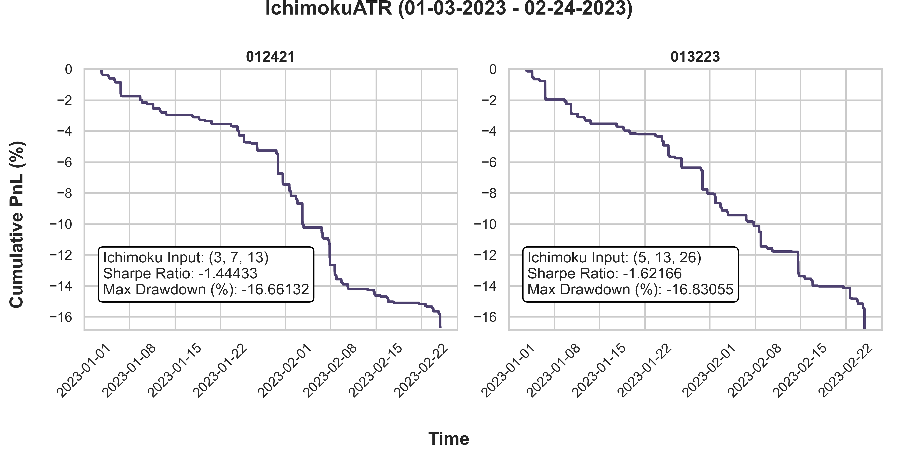

# Retail to HFT: Ichimoku & Moving-Average Market Making

This was the FIN 556 (Algorithmic Market Microstructure) final project at UIUC, Fall 2023. We asked whether retail technical indicators can drive a high-frequency market-making strategy.

We implemented four strategies in C++ on RCM-X Strategy Studio and backtested them tick by tick:
- **SPY** on IEX data, Jan 3 – Feb 24, 2023
- **SOL/USDT** on Gate.io order-book data, January 2022

**Full write-up:** [`FinalReport.md`](FinalReport.md)

## Strategies

Each strategy runs the same finite-state machine: no position → working order → open position → exit on stop-loss, take-profit or a new signal.

| Strategy | Signal |
|---|---|
| Basic MA | Short/long moving-average crossover |
| Market-making VWAP | Short/long VWAP crossover |
| MA + ATR prediction | Crossover of the *predicted* next-candle MAs, using ATR to project the next candle |
| Ichimoku + ATR prediction | Crossover of the predicted Conversion and Base lines (Ichimoku Kinko Hyo) |

Candlesticks are built online from trades in a deque-based queue, which tracks the best bid and ask across the short, medium and long windows.

## Results

| Strategy | Market | Net P&L |
|---|---|---|
| Basic MA | SPY (cash equity) | −$105,559 |
| Market-making VWAP | SPY | −$304,236 |
| Ichimoku + ATR | SPY | −$168,305 |
| Basic MA | SOL/USDT | +$1,563 |
| Ichimoku + ATR | SOL/USDT | +$1,646 |
| VWAP | SOL/USDT | +$623 |

The strategies **lost money on equities and made money on crypto**. The equity runs had only IEX quotes and book data while trading the whole market's trade flow, and the window was a high-VIX, news-heavy period. A latency sweep on the Ichimoku strategy, at 1 ms / 10 ms to and from the exchange, showed P&L *improving* with latency, because fewer losing orders got filled. Section 9 of the report discusses both effects.



## Repository layout

```
BasicMA/, MVWAP/, IchimokuATR/, DMM/      equity strategies (Strategy Studio C++), with P&L results
*Crypto/                                  crypto versions of the strategies
CandlestickLogger/                        candlestick construction and logging
Analytics/                                data parsing, Gate.io L2 download scripts, dashboards
Strategy/, Models/, Training/             Python prototyping, ATR forecasting, LSTM experiments (not used in final strategies)
Research/, Docs/                          strategy research notes
FinalReport.md                            full report
```

Market data isn't redistributed. The IEX feeds were downloaded and parsed with Prof. David Lariviere's IEX downloader/parser; the Gate.io scripts are in `Analytics/crypto/`.

## Team

- **Michael Bhang** came up with the strategy ideas (Ichimoku, directional market making), designed the Python architecture, built the non-ML prediction models for the MA and Ichimoku strategies, implemented stop-losses and ran the backtests.
- **Ashitabh Misra** set up the shared backtesting server, implemented the Strategy Studio strategies, wrote the optimized candlestick parser and utilities, and built the baseline LSTM.
- **Akshay Pandit** led the crypto strategies, pulled Gate.io order-book data, wrote a symbol-agnostic crypto parser and ran the crypto backtests.
- **Laxmi Vijayan** researched strategy venues and ML options, analyzed the data and built the visualizations.
